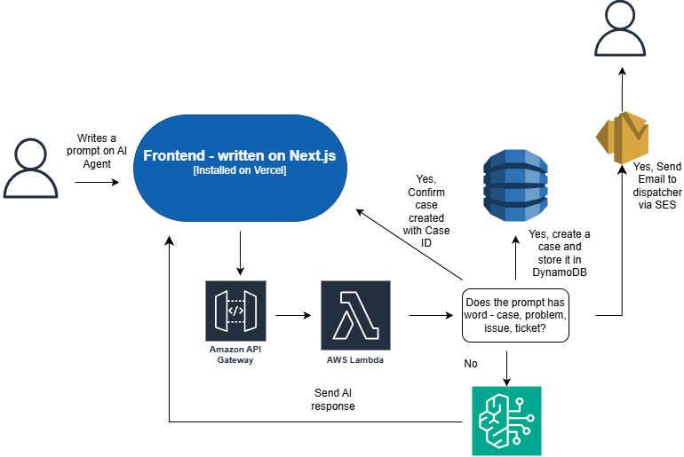

# AI Case Agent

An LLM-powered support agent that answers user questions and **automatically opens a support case** when a message describes a problem. The model decides whether a case is needed and how urgent it is; cases are stored in DynamoDB and the support team is notified by email. Serverless backend on AWS (Terraform) with a Next.js frontend on Vercel.

## System Architecture



## How it works

1. The user sends a message from the Next.js frontend.
2. `POST /submit` on **API Gateway** invokes the **Lambda** (Node.js 20).
3. The Lambda calls the **OpenAI** API with a structured-output prompt. The model returns its reply plus a decision: `create_case`, `priority` and a one-line `summary`.
4. If a case is needed, the Lambda writes it to **DynamoDB** and emails the support team through **Amazon SES**.
5. If the LLM is unavailable, the agent falls back to keyword detection so problem reports still become cases.

## What this demonstrates

- LLM agent pattern: the model both answers and takes an action (ticket creation) based on structured JSON output
- Serverless architecture: API Gateway HTTP API, Lambda, DynamoDB (on-demand, point-in-time recovery), SES
- Secret management: the OpenAI key lives in AWS Secrets Manager; no keys or emails in source code
- Least-privilege IAM, API throttling to cap LLM spend, CORS restricted to your frontend
- Infrastructure as code with Terraform

## Deploy the backend

Prerequisites: an AWS account, AWS CLI configured for `us-east-1`, Terraform ≥ 1.5, Node.js 20.

```bash
cd Backend/terraform_code/backend
npm ci                       # dependencies are packaged into the Lambda zip
cd ..

terraform init
terraform apply \
  -var admin_email=support@example.com \
  -var ses_from_email=noreply@example.com
```

Then:

1. **Verify the sender:** AWS emails a verification link to `ses_from_email`; click it. While your SES account is in the sandbox, `admin_email` must be verified too.
2. **Store the OpenAI API key** in the secret Terraform created:

   ```bash
   aws secretsmanager put-secret-value \
     --secret-id "$(terraform output -raw openai_secret_arn)" \
     --secret-string "sk-..."
   ```

## Deploy the frontend

1. Set `NEXT_PUBLIC_API_URL` to the `api_url` Terraform output: in `Frontend/.env.local` for local development (see `.env.example`), or in the Vercel project's environment variables.
2. Run locally with `npm install && npm run dev` in `Frontend/`, or import the `Frontend` folder as a Vercel project.
3. Optionally lock CORS to your site: `terraform apply -var 'allowed_origins=["https://your-app.vercel.app"]' ...`

## Try it

```bash
curl -X POST "$(terraform output -raw api_url)" \
  -H "Content-Type: application/json" \
  -d '{"message": "The VPN keeps disconnecting every few minutes"}'
```

## Clean up

```bash
terraform destroy -var admin_email=... -var ses_from_email=...
```
